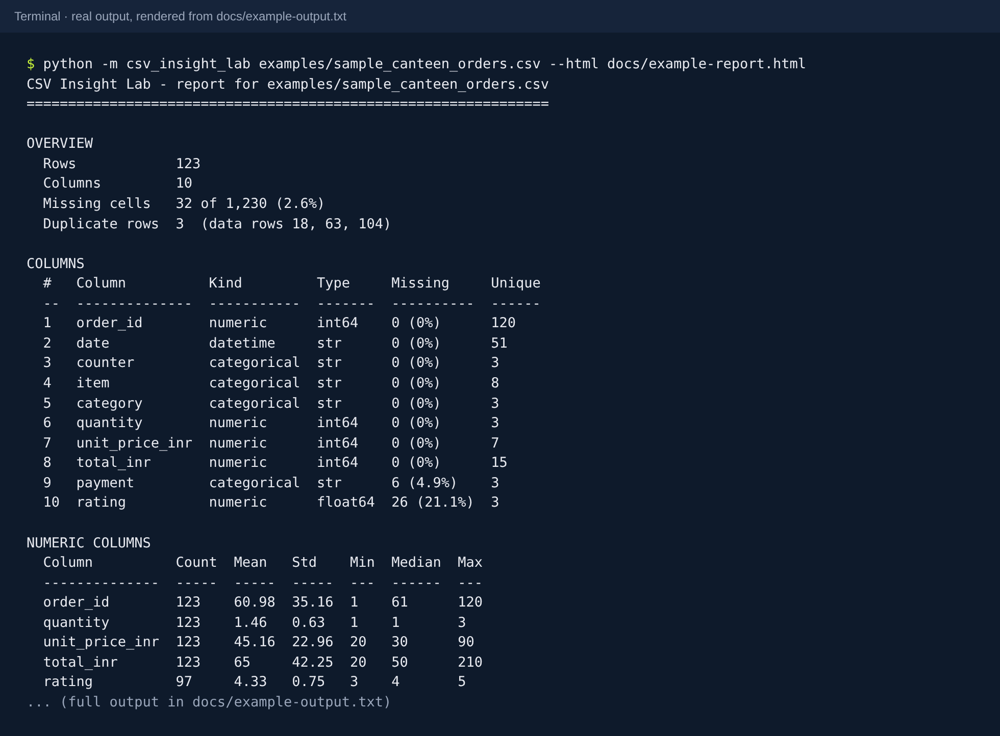
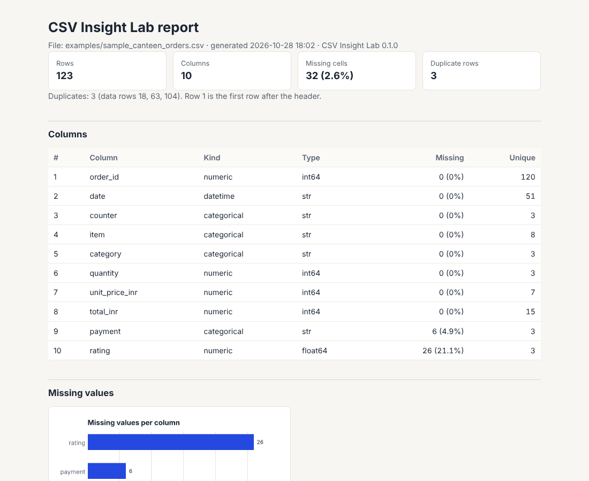

# CSV Insight Lab

A small command-line tool that gives you a readable first look at a CSV file: its size, what each column contains, what is missing, which rows are duplicated, and how the values are distributed. It can also save a one-file HTML report with charts.



**Status:** v0.1, working and tested (32 automated tests). A first-year solo project.

---

## Why this project

Almost every data task begins the same way: someone hands you a spreadsheet export and you need to know what is actually in it before you can trust it. Are there gaps? Duplicates? Is the "date" column really dates? I wanted a first project that solves that small, real problem properly: one that handles bad input without crashing, has tests, and that I can explain line by line.

I deliberately did **not** add machine learning or AI features. The goal of v0.1 is a dependable foundation.

## What it does

- Loads a CSV file and explains clearly when it can't (missing file, empty file, wrong text encoding, rows with too many fields).
- Reports the number of rows and columns, missing cells, and exact duplicate rows (with their row numbers).
- Classifies every column as **numeric**, **categorical**, **datetime**, **boolean**, **text** or **empty**.
- Summarises numeric columns (count, mean, standard deviation, min, quartiles, max).
- Lists the most common values in categorical columns.
- Points out things worth a second look: likely ID columns, constant columns, columns with 20% or more missing.
- Optionally writes a self-contained **HTML report** with charts (`--html`).

## What it does not do (yet)

- It does not clean or change your data; it only reports.
- It reads the whole file into memory, so very large files (hundreds of MB) will be slow.
- It only recognises dates in the unambiguous ISO format (`2026-10-28`). See *Design decisions*.
- It does not guess the separator automatically; use `--sep ";"` for semicolon files.

## Install and run

You need Python 3.10 or newer.

```bash
git clone https://github.com/GITHUB_USERNAME/csv-insight-lab.git
cd csv-insight-lab
python -m venv .venv
# Windows: .venv\Scripts\activate      macOS/Linux: source .venv/bin/activate
pip install -r requirements.txt
```

Run it on the included sample file:

```bash
python -m csv_insight_lab examples/sample_canteen_orders.csv
python -m csv_insight_lab examples/sample_canteen_orders.csv --html report.html
```

All options:

| Option | Meaning |
|---|---|
| `--sep ";"` | Column separator (default `,`) |
| `--encoding latin-1` | Text encoding, if the file is not UTF-8 |
| `--skip-bad-lines` | Skip rows with too many fields instead of stopping (they are counted in the report) |
| `--top 10` | How many common values to list per categorical column (default 5) |
| `--html PATH` | Also save an HTML report with charts |

The program exits with code `0` on success and `1` if the file could not be read, so it can be used in scripts.

## Sample input and output

`examples/sample_canteen_orders.csv` is a **synthetic** dataset: 123 made-up canteen orders created by `examples/make_sample_data.py` with a fixed random seed. Missing ratings, missing payment methods and three duplicate rows were added on purpose so the tool has something to find.

- Full text output: [`docs/example-output.txt`](docs/example-output.txt)
- HTML report: [`docs/example-report.html`](docs/example-report.html) (download and open in a browser)

Excerpt of the end of the text report:

```
WORTH A SECOND LOOK
  - 3 row(s) are exact copies of an earlier row.
  - order_id: Almost every value is different (120 of 123). This may be an ID column.
  - rating: 21.1% of values are missing.
```



## Project structure

```
csv-insight-lab/
├── csv_insight_lab/
│   ├── loader.py        # reads the CSV; turns every expected failure into a clear message
│   ├── profiler.py      # pure calculations: column kinds, missing values, duplicates, summaries
│   ├── report.py        # formats the text report
│   ├── html_report.py   # builds the self-contained HTML report
│   ├── charts.py        # matplotlib charts, returned as PNG bytes
│   ├── cli.py           # command-line arguments and the overall pipeline
│   └── __main__.py      # lets you run `python -m csv_insight_lab`
├── tests/               # pytest tests for every module
├── examples/            # synthetic sample data and the script that generates it
├── docs/                # example outputs and screenshots
├── requirements.txt
└── requirements-dev.txt
```

The flow is: **load → profile → report**. Each step lives in its own module and can be tested on its own.

## Design decisions

1. **Calculations and presentation are separate.** `profiler.py` returns plain data and never prints. That made it easy to test numbers directly (e.g. that the mean of a column with a missing value is calculated from the remaining values) and to add the HTML report later without touching the calculations.
2. **Friendly errors instead of tracebacks.** Expected problems raise `CSVLoadError` with a message that tells the user what to do next, such as trying `--encoding latin-1`.
3. **Only ISO dates are detected.** `03/04/2026` is 3 April in India and 4 March in the USA. Guessing would silently be wrong for someone, so ambiguous formats stay as text.
4. **A rule for "categorical".** A text column is categorical if it has at most 20 distinct values *and* values repeat (distinct values are at most half of the non-missing values). Otherwise it is free text. Both numbers are documented constants in `profiler.py`.
5. **Likely IDs are flagged, not plotted.** Whole-number or text columns where at least 95% of values are different are flagged as possible IDs and get no chart, because a histogram of order numbers means nothing. Decimal numbers are excluded from this rule: measurements are often all different too.
6. **Small whole-number columns get one bar per value.** For columns like quantity (1–3) or rating (3–5), a histogram invents bins such as 1.00–1.67. These are drawn as one bar per value instead.
7. **The HTML report is one file and escapes all CSV text.** Charts are embedded, so the report works offline and can be emailed. Column names and values go through `html.escape()`, so a CSV containing `<script>` cannot run code in the browser (there is a test for this).
8. **ASCII-only text report.** No arrows or box characters, so it prints correctly in older Windows terminals.

## How it was tested

```bash
pip install -r requirements-dev.txt
pytest
```

The 32 tests cover: normal files, missing files, folders, empty and blank files, header-only files, malformed rows (stopping vs. skipping), Excel's byte-order mark, wrong encodings, custom separators, column classification, hand-calculated statistics, duplicate detection, ID detection, date detection (including the ambiguous-format case), HTML escaping, and the command-line exit codes.

Developed and tested with Python 3.13, pandas 3.0 and matplotlib 3.11. Older versions within the ranges in `requirements.txt` are expected to work but have not been tested.

Two bugs were found by **looking at the generated report**, not by the tests: the ID column was being drawn as a histogram (the duplicate rows hid that it was an ID), and quantity/rating had misleading histogram bins. Both are fixed and now have tests.

## How this was built

I built this with an AI coding assistant (Claude). My part was choosing the scope, reviewing the modules, and running the program and the tests myself. The two bugs above are a good reminder of why that review matters: generated code and a confident-looking report can still be wrong. The commit history shows the order in which the project was built.

## Possible improvements

- Detect the separator automatically (Python's `csv.Sniffer`).
- Read very large files in chunks.
- Export the profile as JSON so other programs can use it.
- Let the user choose the categorical and ID thresholds with options.
- A simple web interface for people who don't use the terminal.

## Libraries used

- [pandas](https://pandas.pydata.org/) for reading the CSV and calculating statistics (BSD-3-Clause licence)
- [matplotlib](https://matplotlib.org/) for the charts (Matplotlib licence, BSD-compatible)
- [pytest](https://pytest.org/) for the tests (MIT licence)

## Licence

MIT. See [LICENSE](LICENSE).
